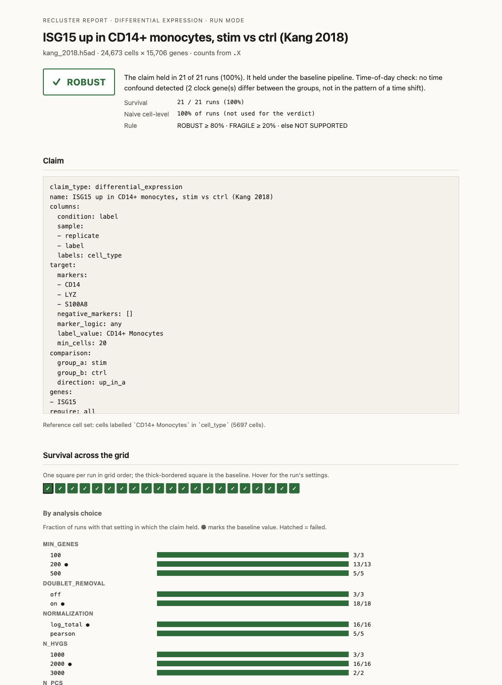

# Recluster

An independent stress test for single-cell RNA-seq claims.
For anyone who has to decide whether a single-cell result, produced by a person or by an AI agent, holds up.
Everyone is building AI that does the analysis. Recluster tells you whether to believe it.

[](https://github.com/pranakkin/Recluster/actions/workflows/ci.yml)



## What it does

You give Recluster an AnnData file with raw counts and a claim:

- *"Cell population X exists."*
- *"Cell type X is more abundant in condition A than B."*
- *"Gene G is up in cell type X in condition A vs B."*

It re-runs the analysis across a bounded grid of defensible alternative choices (QC thresholds,
doublet removal, normalisation, number of variable genes and principal components, clustering
resolution, batch correction, random seeds; about 21 to 24 runs by default) and reports how
often, and under which choices, the claim survives. Composition and expression claims are tested
across biological replicates, never across cells, paired on the donor when the design allows it,
and the naive cell-level result is shown next to the replicate-aware one so pseudoreplication is
visible rather than hidden. Every comparison claim also gets a time-of-day check: with collection
times, whether the groups were sampled at different hours and whether the effect survives
adjusting for time; without them, whether the groups differ in core clock-gene state in the
pattern a time shift produces.

The output is one self-contained HTML report per claim: a verdict (`ROBUST`, `FRAGILE`,
`NOT SUPPORTED`), a survival chart, the choices that broke the claim, the replicate-aware versus
cell-level comparison, the time-of-day check, a deterministic methods paragraph, and a full
provenance log. Every number comes from deterministic code; a language model is only ever used,
optionally, to draft the claim file from a sentence or to write a labelled summary of numbers the
code already computed.

Browse the benchmark reports: **https://pranakkin.github.io/Recluster/** (GitHub Pages from `docs/`).

## The failures Recluster catches

Two failure modes that standard single-cell analyses do not check for, each with a benchmark
case that plants the failure into real data and records what happens. Numbers are from
[bench/RESULTS.md](bench/RESULTS.md), exactly as measured.

**Pseudoreplication.** Testing a condition effect across cells instead of across donors treats
thousands of cells from one person as thousands of independent observations, and it calls
differences that are not there (Squair et al., *Nat Commun* 2021). The benchmark takes Kang et
al. 2018 (8 donors, IFN-β vs control) and builds claims that are false by construction: control
cells only with the donors split into two fake groups, and all cells with the condition label
shuffled at the donor level. Across the grid the naive cell-level tests call three of the four false claims in 100 % of runs and the fourth in 24 %; the replicate-aware verdict is NOT SUPPORTED for all four, and the three expression claims carry the pseudoreplication flag. The true claims (interferon-stimulated genes up after IFN-β) are ROBUST in 21 of 21 runs each.

**Time of collection.** Core clock genes differ between day and night in most human tissues
(Wucher et al., *PLoS Biol* 2023), so a cohort sampled in the morning compared with one sampled in
the afternoon shows "condition effects" that are time effects. No standard workflow checks this.
The benchmark splits the Kang donors into two fake groups, gives the first morning collection
times and the second afternoon times, and plants a documented clock-gene shift plus a rhythmic
gene (SQSTM1) into every cell as a smooth function of the hour. The planted claim, SQSTM1 up in CD14+ monocytes in the afternoon group, holds in 21 of 21 runs (pseudobulk DESeq2 on 4 vs 4 donors: log2 fold change 0.66, adjusted p = 0.007), so a standard analysis reports a condition effect. With the collection times hidden, the clock-gene screen separates the groups on the clock-state index (permutation p = 0.029) and caps the verdict at FRAGILE; with the times given, the groups are 5.8 h apart and refitting with cos/sin of the hour turns the fold change into −0.55 (adjusted p = 0.17), so the claim is NOT SUPPORTED as explained by collection time. On the eight comparison claims without a planted time effect the check raised no alarm; on the real IFN-β comparisons it notes that two clock genes differ, in a pattern that is not a time shift.

## Quickstart: reproduce the Kang 2018 benchmark

Requires Python 3.11 and [uv](https://docs.astral.sh/uv/).

```bash
git clone https://github.com/pranakkin/Recluster.git && cd Recluster
```
```bash
uv sync
```
```bash
uv run recluster bench --part kang
```

That downloads the Kang et al. 2018 PBMC dataset (38 MB, checksum verified) and the two original
10x lanes with demuxlet calls from GEO (60 MB), builds twelve claims (true, null, false by
construction, and two with a planted time-of-day effect), runs each on the full grid in
parallel, and writes `bench/results.json`, `bench/results_table.md` and a report per claim under
`bench/out/`. About 20 minutes on a laptop; `--part all` adds the planted errors on PBMC3k (the whole
benchmark took 25 minutes with 4 workers); `--max-runs 2` gives a short smoke version.

To run one claim instead:

```bash
uv run python scripts/download_kang.py
```
```bash
uv run recluster run --data data/kang_2018.h5ad --claim examples/claims/kang_isg15_cd14_monocytes.yaml
```

Open `results/<claim>/report.html`. A synthetic example that needs no download is in
`examples/claims/synthetic_*.yaml` (`uv run python scripts/make_synthetic_example.py` first).

## Benchmark, exactly as measured

Default grid, default thresholds. The pass rules were written before each case ran; the one
rule and the handful of thresholds that changed between the first run and this one are listed
with their reasons in [bench/RESULTS.md](bench/RESULTS.md), together with the first run's table.

| # | Case | Expected | Verdict | Held | Time check | Outcome |
|---|---|---|---|---|---|---|
| 1 | Kang: ISG15 up in CD14+ monocytes, stim vs ctrl | ROBUST | ROBUST | 21/21 | none | correct |
| 2 | Kang: ISG15, IFI6, IFIT3, MX1 all up in CD14+ monocytes | ROBUST | ROBUST | 21/21 | none | correct |
| 3 | Kang: ISG15 up in CD4 T cells | ROBUST | ROBUST | 21/21 | none | correct |
| 4 | Kang: CD14+ monocytes exist across donors | ROBUST | ROBUST | 21/21 | – | correct |
| 5 | Kang: NK cells exist across donors | ROBUST | ROBUST | 20/21 | – | correct |
| 6 | Kang: monocyte proportion differs stim vs ctrl (no known shift) | NOT SUPPORTED | FRAGILE | 11/21 | none | false alarm |
| 7 | False: ISG15 differs between fake donor groups (ctrl only) | NOT SUPPORTED | NOT SUPPORTED | 1/21 | none | correct |
| 8 | False: LYZ differs between fake donor groups (ctrl only) | NOT SUPPORTED | NOT SUPPORTED | 0/21 | none | correct |
| 9 | False: monocyte proportion differs between fake donor groups | NOT SUPPORTED | NOT SUPPORTED | 0/21 | none | correct |
| 10 | False: ISG15 up in fake group A (donor-level shuffle) | NOT SUPPORTED | NOT SUPPORTED | 0/21 | none | correct |
| 11 | Planted time-of-day effect claimed as a condition effect, times hidden | held, then flagged | FRAGILE (ROBUST before the time check) | 21/21 | POSSIBLE | caught |
| 12 | The same planted effect with collection times given | held, then removed by adjustment | NOT SUPPORTED (ROBUST before the time check) | 21/21 | POSSIBLE | caught |
| 13 | Planted: 150 synthetic doublets as a fake population | not ROBUST, doublet axis breaks it | NOT SUPPORTED | 3/23 | – | missed |
| 14 | Planted: over-clustering shard of CD4 T cells | not ROBUST | NOT SUPPORTED | 0/23 | – | caught |
| 15 | Control: a shard that is a whole population (B cells) | ROBUST | ROBUST | 23/23 | – | control OK |
| 16 | Planted: QC threshold deletes NK cells | failure table names max_mito_pct | NOT SUPPORTED | 4/23 | – | caught |
| 17 | Planted: batch artifact claimed as a CD4 T subtype | not ROBUST, batch axis breaks it | NOT SUPPORTED | 4/24 | – | caught |
| 18 | Control: the real CD4 T population under the batch effect | ROBUST | ROBUST | 24/24 | – | control OK |

Three things to read off this table. The replicate-aware tests do their job: every false claim is
NOT SUPPORTED while the naive cell-level tests would have called three of the four in 100 % of
runs. The planted time-of-day effect is caught in both modes, and the check raised no alarm on the
claims without one. The two outcomes against the rules are spelled out in RESULTS.md: the null
composition case is a FRAGILE false alarm because the paired test sees a small, consistent 1.6-point
drop in the monocyte share after IFN-β (there is no ground truth for that case), and the planted
doublet block is rejected for the wrong reason (it only clusters under one normalisation; Scrublet
still flags none of the injected cells). Scrublet against demuxlet on the real lanes, with the
rate-based fallback: AUROC 0.87, precision 0.60, recall 0.54 (0.27 without the fallback).

## Writing a claim

```yaml
claim_type: differential_expression      # population_exists | composition_shift | differential_expression
name: "ISG15 up in CD14+ monocytes, stim vs ctrl"
columns:
  condition: label                       # .obs column with the condition
  sample: [replicate, label]             # biological replicate; a list is combined into one key
  batch: null                            # optional; enables the batch-correction axis
  labels: cell_type                      # optional; existing labels become the reference set
  collection_time: null                  # optional; clock time per cell ("09:30", hours, or a datetime)
target:
  markers: [CD14, LYZ, S100A8]           # and/or label_value
  marker_logic: any                      # any: mean marker expression; all: every marker (co-expression)
  label_value: "CD14+ Monocytes"
comparison:
  group_a: stim
  group_b: ctrl
  direction: up_in_a
genes: [ISG15]
tissue: null                             # optional, recorded with the day-night gene overlap
```

`recluster run` re-derives everything from raw counts. `recluster audit` takes an object another
tool produced (processed matrix plus raw counts in `layers['counts']` or `.raw`) and checks its
labels against a fresh derivation. Grid axes and thresholds can be overridden with `--grid` and
`--thresholds` YAML files; every report prints the values used.

## Optional LLM layer

Everything above works with hand-written YAML and no API key. With `ANTHROPIC_API_KEY` set (in
the environment or a gitignored `.env`):

```bash
uv run recluster parse "ISG15 is up in CD14 monocytes after IFN-beta" --data data/kang_2018.h5ad --out claim.yaml
```

proposes a claim file. The model sees only the `.obs` column names and values and which gene
symbols from the sentence exist in the data; the proposal is validated against the file and shown
to you, labelled as LLM output, before it is written. `--summarize` on a run adds a paragraph
headed "LLM summary of computed results"; a guard discards any summary containing a number the
code did not compute.

## Design principles

- **Deterministic stress test.** Every stochastic step is seeded and neighbour search is exact;
  re-running a config reproduces the numbers, and tests check it for every claim type.
- **Replicate-aware statistics.** Donors, not cells, are the unit of inference: a t-test on logit
  proportions and DESeq2 on per-donor pseudobulk, both paired on the donor when every donor
  appears in both groups. The cell-level result is shown for contrast and raises a
  pseudoreplication flag when it disagrees.
- **Time-of-day awareness.** Every comparison claim is screened for a collection-time confound,
  at the level of the donor, with a documented panel of core clock genes when no times are
  given. A possible confound lowers the verdict; an effect that disappears once time is adjusted
  for is reported as explained by time.
- **Choices adapted to the data, and recorded.** A QC threshold that would remove more than a
  quarter of the cells is pulled back and the run says so; a population is matched within each
  sample so that the mix of other cell types cannot move the score; Scrublet gets a fallback tied
  to the expected doublet rate when its threshold calls nothing. Each adaptation is written into
  the run's provenance.
- **Provenance.** Package versions, input hash, grid, thresholds and every run's requested and
  effective parameters and outputs are written to `provenance.json` and embedded in the report.
- **LLM only at the edges.** It may draft a claim file (checked against the data, confirmed by
  you) and summarise computed numbers (guarded). It never touches a computation.
- **Explicit thresholds.** All cutoffs are configurable and printed; changes are logged with
  reasons in `PLAN.md` and `bench/RESULTS.md`.

[docs/HOW_IT_WORKS.md](docs/HOW_IT_WORKS.md) explains every design choice and test.

## Limitations

- A population that exists in only one condition cannot be tested as a composition shift: the
  tool cannot tell a biological absence from the clustering having lost that condition's version
  of the population, so such runs are reported as not testable and count against the claim.
- With three or fewer donors per group no permutation test can reach p < 0.05. The time check
  then judges balance from the difference in mean collection time alone, and the clock-gene
  screen is reported as not assessable rather than as reassurance.
- The clock-gene screen cannot distinguish a treatment that moves clock genes in the antiphase
  pattern of a time shift from a real time difference, and it does not estimate circadian phase.
  A treatment that shifts clock genes uniformly (IFN-β does) is reported as a note, not a confound.
- The day-night gene list (Wucher et al. 2023) is gene-level, so the overlap check is not
  tissue-specific; the `tissue` field is recorded, not used.
- The expected doublet rate assumes each sample was captured on its own lane; for samples
  demultiplexed from a pooled lane the true expectation is the lane's.
- Scrublet, with or without the fallback, does not catch a block of near-identical synthetic
  doublets, and the cluster-level mixture diagnostic has no cutoff that separates doublet clusters
  from genuine intermediate populations; it is shown in the report but never changes a verdict.
- Marker-based matching of CD4 T cells is weak at low clustering resolution; the labels, when a
  claim gives them, carry those runs.
- Runs within a claim are sequential; the LLM layer's two live API calls were built against the
  current SDK reference and tested with fake clients, not against the live API.

## Roadmap

The main direction is **audit mode for agent outputs**: take the object an analysis agent
hands back, re-derive from its stored counts, and report which of its labels, abundances and
marker calls survive. Concretely, next:

1. Per-condition population matching, so a treatment that remodels marker expression does not
   drop a population out of one condition.
2. A lane column for the expected doublet rate, and a doublet check that works on a block of
   identical doublets.
3. Tissue-specific rhythmic gene lists when a public per-tissue table becomes available, and a
   phase estimate only if a validated method for sparse data exists.
4. Grid runs in parallel; an audit summary across all labels in an object, not one claim at a
   time.

## Repository layout

```
recluster/            engine: spec, pipeline, grid, matching, evaluators, time_confound, verdict, report, llm, bench
recluster/resources/  daynight_genes.csv, built from Wucher et al. 2023 S8 (CC BY 4.0) by scripts/fetch_daynight_genes.py
bench/                benchmark runner outputs: RESULTS.md, results.json, results_table.md (and the first run's copies)
docs/                 GitHub Pages: index.html, reports/, HOW_IT_WORKS.md, report-screenshot.png
examples/claims/      claim YAML examples (synthetic, PBMC3k, Kang)
scripts/              make_synthetic_example.py, make_processed_example.py, download_kang.py, fetch_daynight_genes.py, build_docs.py
tests/                180 offline tests on synthetic data
```

## Troubleshooting

**`No module named recluster` on macOS after `uv sync`.** If the repository lives inside
`~/Desktop` (or another folder where macOS flags dot-directories as hidden), the `.venv` files
inherit the Finder hidden flag and recent CPython releases skip hidden `.pth` files. Run:

```bash
chflags -R nohidden .venv
```

## Built by

Pranavi Akkinepally, Johns Hopkins.

MIT licensed.
