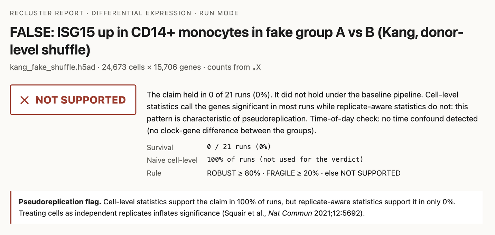

# Recluster

[](https://github.com/pranakkin/Recluster/actions/workflows/ci.yml)

Recluster re-runs a single-cell RNA-seq analysis across other defensible choices and reports
whether a claim survives.

A single-cell result comes from one pipeline run, but the QC cutoffs, normalisation, clustering
resolution, batch correction and the unit of the statistical test could each have gone another
defensible way. Recluster runs the analysis across that grid, tests on donors rather than
cells, checks whether the groups were sampled at different times of day, and returns ROBUST,
FRAGILE or NOT SUPPORTED with the choices that broke the claim.

**On Kang et al. 2018 (8 donors), naive cell-level tests call three of four false-by-construction
claims in 100 % of grid runs. Recluster returns NOT SUPPORTED for all four, and the three true
interferon claims are ROBUST in 21 of 21 runs.** Across 20 benchmark cases, each with a pass rule
written before it ran (one rule was tightened between runs, see bench/RESULTS.md): 16 as
expected, 1 false alarm and 3 misses (all three planted-doublet cases). Details in
[bench/RESULTS.md](bench/RESULTS.md).

Requires Python 3.11 and [uv](https://docs.astral.sh/uv/).

```bash
git clone https://github.com/pranakkin/Recluster.git && cd Recluster
uv sync
uv run recluster demo     # one true claim (ROBUST 21/21), one false (NOT SUPPORTED 1/21)
```



*A claim that is false by construction (donors shuffled between two fake groups): the cell-level test calls it in every run, the donor-level test in none. [Full report](https://pranakkin.github.io/Recluster/reports/kang/false-isg15-up-in-cd14-monocytes-in-fake-group-a-vs-b-kang-d.html).*

## What it does

You give Recluster an AnnData file with raw counts and a claim:

- *"Cell population X exists."*
- *"Cell type X is more abundant in condition A than B."*
- *"Gene G is up in cell type X in condition A vs B."*

It re-runs the analysis across a bounded grid of defensible alternative choices (QC thresholds,
doublet removal with Scrublet (Wolock et al. 2019), log or Pearson-residual normalisation
(Lause et al. 2021), number of variable genes and principal components, Leiden clustering
resolution (Traag et al. 2019), batch correction with Harmony (Korsunsky et al. 2019), random
seeds; about 21 to 24 runs by default) and reports how often, and under which choices, the
claim survives. Composition and expression claims are tested across biological replicates,
never across cells, paired on the donor when the design allows it, and the naive cell-level
result is shown next to the replicate-aware one so the effect of pseudoreplication can be seen.
Every comparison claim also gets a time-of-day check: with collection
times, whether the groups were sampled at different hours and whether the effect survives
adjusting for time; without them, whether the groups differ in core clock-gene state in the
pattern a time shift produces.

The output is one self-contained HTML report per claim: a verdict (`ROBUST`, `FRAGILE`,
`NOT SUPPORTED`), a survival chart, the choices that broke the claim, the replicate-aware versus
cell-level comparison, the time-of-day check, a deterministic methods paragraph, and a full
provenance log. Every number comes from deterministic code; see
[Optional LLM layer](#optional-llm-layer) for the two places a language model can be used.

A claim is ROBUST if it holds in at least 80 % of grid runs, FRAGILE at 20 to 80 %, and NOT
SUPPORTED below 20 %; runs that cannot test the claim count as failures. A possible time-of-day
confound caps the verdict at FRAGILE, and an effect that disappears once time is adjusted for is
NOT SUPPORTED.

The benchmark reports, one page per case: https://pranakkin.github.io/Recluster/

## Two failure modes

Default single-cell workflows do not check for either of these. Both are tested on Kang et al.
2018; numbers are from [bench/RESULTS.md](bench/RESULTS.md).

**Pseudoreplication.** Testing a condition effect across cells instead of across donors treats
thousands of cells from one person as thousands of independent observations and reports
differences that are not there ([Squair et al., *Nat Commun* 2021](https://doi.org/10.1038/s41467-021-25960-2)).
Pseudobulk and mixed-model methods address this (Crowell et al. 2020; Zimmerman et al. 2021);
Recluster tests on per-donor pseudobulk and per-donor proportions by default and shows the naive
cell-level result next to them. The benchmark takes
[Kang et al. 2018](https://doi.org/10.1038/nbt.4042) (8 donors, IFN-β vs control) and builds
claims that are false by construction: control cells only with the donors split into two fake
groups, and all cells with the condition label shuffled at the donor level.

- Four false claims. Naive cell-level tests call three of them in 100 % of runs and the fourth
  in 24 %.
- Recluster returns NOT SUPPORTED for all four, and the three expression claims carry the
  pseudoreplication flag.
- The true claims (interferon-stimulated genes up after IFN-β) are ROBUST in 21 of 21 runs each;
  ISG15's pseudobulk log2 fold change in CD14+ monocytes is 7.71 with the labels as given.

**Time of collection.** Core clock genes (Takahashi 2017) differ between day and night in most
human tissues ([Wucher et al., *PLoS Biol* 2023](https://doi.org/10.1371/journal.pbio.3001986)),
so a cohort sampled in the morning compared with one sampled in the afternoon can show
"condition effects" that are time effects. The benchmark splits the Kang donors into two fake
groups, gives the first morning collection times and the second afternoon times, and plants a
documented clock-gene shift plus a rhythmic gene (SQSTM1) into every cell as a smooth function
of the hour.

- Naive analysis: the planted claim, SQSTM1 up in CD14+ monocytes in the afternoon group, holds
  in 21 of 21 runs (pseudobulk DESeq2 on 4 vs 4 donors: log2 fold change 0.66, adjusted
  p = 0.007). Without the time check, this is reported as a condition effect.
- Times hidden: the clock-gene screen separates the groups on the clock-state index
  (permutation p = 0.029, the smallest p a 4 vs 4 permutation test can give) and caps the
  verdict at FRAGILE.
- Times given: the groups were sampled 5.8 h apart. Refitting with cos/sin of the hour turns the
  fold change into −0.55 (adjusted p = 0.17), so the claim is NOT SUPPORTED, explained by
  collection time. By construction there is no group effect beyond time, so the negative
  estimate is not an opposite effect; with non-overlapping collection hours, group and time are
  hard to separate.
- No planted effect: on the eight other comparison claims, which use three distinct group
  comparisons (stim vs ctrl, a fake donor split, a donor-level shuffle), the check raised no
  alarm. On stim vs ctrl it notes that two clock genes differ, not in the pattern of a time
  shift. The rule that decides this was settled after seeing that result (see
  [bench/RESULTS.md](bench/RESULTS.md)).

## Quickstart

The three commands at the top install Recluster and run the demo. The demo downloads Kang et al.
2018 (38 MB, checksum verified, cached in `data/`), takes a seeded subset of 200 cells from each
of the 16 donor x condition samples, and runs two claims on the full default grid of 21 runs:
ISG15 rises in CD14+ monocytes after IFN-β (true), and ISG15 differs between two fake groups
of control donors (false by construction). It opens both reports. On an Apple M5 Pro laptop with
the data already downloaded it took 2 minutes 7 seconds with 8 worker processes; the true claim
came out ROBUST (21 of 21 runs) and the false one NOT SUPPORTED (1 of 21). `--no-open` skips
opening the browser and `--jobs` sets the number of workers. Reports are written to
`results/demo/`.

### Check a clean install

`scripts/verify_reproduction.sh` clones the repository into a temporary folder, installs it with
`uv sync --frozen`, runs `recluster demo`, and prints the two verdicts and a SHA-256 hash of the
key numbers (verdicts, per-run cells, clusters, outcomes and pseudobulk fold changes).
`scripts/demo_hash.py` compares the hash with a recorded one; no hash has been recorded yet, so
for now it always reports a difference.

### Run the Kang 2018 benchmark

```bash
uv run recluster bench --part kang
```

That downloads the Kang et al. 2018 PBMC dataset (38 MB, checksum verified) and the two original
10x lanes with demuxlet calls from GEO (60 MB), builds twelve claims (true, null, false by
construction, and two with a planted time-of-day effect), runs the claims in parallel, each on
the full grid, and writes `bench/results.json`, `bench/results_table.md` and a report per claim
under `bench/out/`. In the recorded run the twelve Kang claims took 7,202 s of claim time in
total, about 30 minutes if spread evenly over the default 4 workers; the Kang part has not been
timed on its own. `--part all` adds the planted errors on PBMC3k; the whole benchmark took 38
minutes with 4 workers. `--max-runs 2` gives a short smoke version.

The run rewrites the committed `bench/results.json` and `bench/results_table.md`; with `--part`,
the rewritten files hold only that part's cases. `git diff bench/` shows any difference and
`git checkout bench/results.json bench/results_table.md` restores them.

To run one claim instead:

```bash
uv run python scripts/download_kang.py
uv run recluster run --data data/kang_2018.h5ad --claim examples/claims/kang_isg15_cd14_monocytes.yaml
```

Add `--jobs 8` to spread the grid runs over 8 processes; the results are identical to a
single process.

Open `results/isg15-up-in-cd14-monocytes-stim-vs-ctrl-kang-2018/report.html`. Each claim folder
holds `report.html`, `provenance.json`, `runs.csv` and the validated `claim.yaml`. A synthetic
example that needs no download is in `examples/claims/synthetic_*.yaml`
(`uv run python scripts/make_synthetic_example.py` first).

## Benchmark

16 of 20 as expected; **1 false alarm** (case 6); **3 misses**, all three planted-doublet cases
(13, 19, 20).

All 20 cases ran on the default grid and thresholds, in 38 minutes with 4 workers on an Apple M5
Pro laptop. The pass rules were written before each case ran; the rule and thresholds that
changed between runs are listed with their reasons in [bench/RESULTS.md](bench/RESULTS.md),
together with the first run's table. The first pass rules were committed together with the first
results (6c2a173), so git does not show their order. The held-out doublet cases and their pass
rules were committed in 6201b82, before the step they test was built (f1dd9ea); both were missed.

Held = grid runs in which the claim held (for comparison claims, by the replicate-aware test).
Cell-level = share of runs where the naive cell-level test would have called the claim. Time
check: none = no time confound detected, POSSIBLE = possible time confound, – = no comparison.

| # | Case | Expected | Verdict | Held | Cell-level | Time check | Outcome |
|---|---|---|---|---|---|---|---|
| 1 | Kang: ISG15 up in CD14+ monocytes, stim vs ctrl | ROBUST | ROBUST | 21/21 | 100 % | none | correct |
| 2 | Kang: ISG15, IFI6, IFIT3, MX1 all up in CD14+ monocytes | ROBUST | ROBUST | 21/21 | 100 % | none | correct |
| 3 | Kang: ISG15 up in CD4 T cells | ROBUST | ROBUST | 21/21 | 100 % | none | correct |
| 4 | Kang: CD14+ monocytes exist across donors | ROBUST | ROBUST | 21/21 | – | – | correct |
| 5 | Kang: NK cells exist across donors | ROBUST | ROBUST | 20/21 | – | – | correct |
| 6 | Kang: monocyte proportion differs stim vs ctrl (no known shift) | NOT SUPPORTED | FRAGILE | 11/21 | 71 % | none | **false alarm** |
| 7 | False: ISG15 differs between fake donor groups (ctrl only) | NOT SUPPORTED | NOT SUPPORTED | 1/21 | 100 % ⚑ | none | correct |
| 8 | False: LYZ differs between fake donor groups (ctrl only) | NOT SUPPORTED | NOT SUPPORTED | 0/21 | 100 % ⚑ | none | correct |
| 9 | False: monocyte proportion differs between fake donor groups | NOT SUPPORTED | NOT SUPPORTED | 0/21 | 24 % | none | correct |
| 10 | False: ISG15 up in fake group A (donor-level shuffle) | NOT SUPPORTED | NOT SUPPORTED | 0/21 | 100 % ⚑ | none | correct |
| 11 | Planted time-of-day effect claimed as a condition effect, times hidden | held, then flagged | FRAGILE (ROBUST before the time check) | 21/21 | 100 % | POSSIBLE | caught |
| 12 | The same planted effect with collection times given | held, then removed by adjustment | NOT SUPPORTED (ROBUST before the time check) | 21/21 | 100 % | POSSIBLE | caught |
| 13 | Planted: 150 synthetic doublets as a fake population | not ROBUST; holds only with doublet removal off | NOT SUPPORTED | 1/23 | – | – | **missed** |
| 14 | Planted: over-clustering shard of CD4 T cells | not ROBUST | NOT SUPPORTED | 0/23 | – | – | caught |
| 15 | Control: a shard that is a whole population (B cells) | ROBUST | ROBUST | 23/23 | – | – | control OK |
| 16 | Planted: QC threshold deletes NK cells | failure table names max_mito_pct | NOT SUPPORTED | 4/23 | – | – | caught |
| 17 | Planted: batch artifact claimed as a CD4 T subtype | not ROBUST; holds only with batch correction off | NOT SUPPORTED | 4/24 | – | – | caught |
| 18 | Control: the real CD4 T population under the batch effect | ROBUST | ROBUST | 24/24 | – | – | control OK |
| 19 | Held out: 150 NK + CD14 monocyte doublets as a fake population | not ROBUST; holds only with doublet removal off | NOT SUPPORTED | 2/23 | – | – | **missed** |
| 20 | Held out: 150 CD8 T + B doublets as a fake population | not ROBUST; holds only with doublet removal off | NOT SUPPORTED | 1/23 | – | – | **missed** |

⚑ = pseudoreplication flag raised by the report (cell-level statistics call the claim in >= 80 %
of runs while replicate-aware statistics call it in < 50 %).

- **Time of day.** The planted effect is caught with collection times hidden and with them
  given. The check raised no alarm on the three group comparisons without one (a rule settled
  after seeing the IFN-β result).
- **Null composition.** Case 6 is a FRAGILE false alarm: the paired test sees a small,
  consistent 1.6-percentage-point drop in the monocyte share after IFN-β. There is no ground
  truth for that case.
- **Doublets.** All three planted doublet blocks end NOT SUPPORTED for the wrong reason: the
  fake population is fragile across normalisations, not removed as doublets. The
  doublet-population step catches the development block where that block clusters on its own
  and removes no real cluster. It missed both held-out blocks. RESULTS.md has the full account.

## Writing a claim

Input: an `.h5ad` whose raw integer counts are in `layers['counts']`, `.raw.X` or `.X`
(searched in that order). The genes a claim names must appear in `var_names`. Comparison claims
need an `.obs` column for the condition and one for the biological replicate. Every column, value
and gene in the claim is checked against the file before anything runs.

```yaml
claim_type: differential_expression      # population_exists | composition_shift | differential_expression
name: "ISG15 up in CD14+ monocytes, stim vs ctrl"
columns:
  condition: label                       # .obs column with the condition
  sample: [replicate, label]             # biological replicate; a list is joined into one key, e.g. [donor, condition]
  batch: null                            # optional; enables the batch-correction axis
  labels: cell_type                      # optional; required with target.label_value and for audit
  collection_time: null                  # optional; collection time of each cell's sample ("09:30", hours, or a datetime)
target:
  markers: [CD14, LYZ, S100A8]           # and/or label_value
  marker_logic: any                      # any: mean marker expression; all: every marker (co-expression)
  label_value: "CD14+ Monocytes"
comparison:
  group_a: stim
  group_b: ctrl
  direction: up_in_a                     # DE: up_in_a | down_in_a | either; composition: higher_in_a | lower_in_a | different
genes: [ISG15]
tissue: null                             # optional, recorded with the day-night gene overlap
```

`recluster run` re-derives everything from raw counts. `recluster audit` takes an object another
tool produced (processed matrix plus raw counts in `layers['counts']` or `.raw`) and checks its
labels against a fresh derivation. Grid axes and thresholds can be overridden with `--grid` and
`--thresholds` YAML files; every report prints the values used.

## Optional LLM layer

Everything above works with hand-written YAML and no API key. To draft a claim file from a
sentence, install the optional dependency with `uv sync --extra llm`, set `ANTHROPIC_API_KEY` (in
the environment or a gitignored `.env`) and run:

```bash
uv run recluster parse "ISG15 is up in CD14 monocytes after IFN-beta" --data data/kang_2018.h5ad --out claim.yaml
```

The model sees only the `.obs` column names and values and which gene
symbols from the sentence exist in the data; the proposal is validated against the file and shown
to you, labelled as LLM output, before it is written. `--summarize` on a run adds a paragraph
headed "LLM summary of computed results"; a guard discards any summary containing a number the
code did not compute.

## Design principles

- **Deterministic stress test.** Every stochastic step is seeded and neighbour search is exact;
  re-running a config reproduces the numbers, and tests check it for all three claim types.
- **Replicate-aware statistics.** Donors, not cells, are the unit of inference: a t-test on logit
  proportions (one of the two transformations propeller offers; Phipson et al. 2022) and DESeq2
  (Love et al. 2014, through PyDESeq2; Muzellec et al. 2023) on per-donor pseudobulk, both paired
  on the donor when every donor appears in both groups. The cell-level result is shown for contrast and raises a
  pseudoreplication flag when it disagrees.
- **Time-of-day awareness.** Every comparison claim is screened for a collection-time confound,
  at the level of the donor, with a documented panel of core clock genes when no times are
  given. A possible confound lowers the verdict; an effect that disappears once time is adjusted
  for is reported as explained by time.
- **Choices adapted to the data, and recorded.** A QC threshold that would remove more than a
  quarter of the cells is pulled back and the run says so; a population is matched within each
  sample so that the mix of other cell types cannot move the score; Scrublet gets a fallback tied
  to the expected doublet rate when its threshold calls fewer than a quarter of the expected
  doublets. Each adaptation is written into the run's provenance.
- **Provenance.** Package versions, input hash, grid, thresholds and every run's requested and
  effective parameters and outputs are written to `provenance.json` and embedded in the report.
- **LLM only at the edges.** It may draft a claim file (checked against the data, confirmed by
  you) and summarise computed numbers (guarded). It never touches a computation.
- **Explicit thresholds.** All cutoffs are configurable and printed in every report. Each change
  is logged with its reason in `PLAN.md` and `bench/RESULTS.md`. The numbers behind the design
  decisions are recomputed by `scripts/design_measurements.py` into
  [bench/design_measurements.md](bench/design_measurements.md). The doublet-population rules,
  threshold and held-out cases can be checked against the git history (6201b82, 8084ad2 and
  1c1e48e, all before f1dd9ea); the earlier pass rules were committed together with the first
  results (6c2a173).

[docs/HOW_IT_WORKS.md](docs/HOW_IT_WORKS.md) explains the design choices and the tests.

## Limitations

- ROBUST means a claim survives the grid of analysis choices, tested across donors; it does not
  mean the claim is true. A flaw built into the experimental design survives every analysis
  choice: in Kang 2018 each condition was captured on its own 10x lane, so a lane artifact would
  also come out ROBUST. Apart from collection time, Recluster cannot detect confounds built into
  the design.
- The survival fraction depends on how many grid runs vary each setting. On the 21-run Kang
  grid three runs use a seed other than the baseline's, so a claim that fails in all three still
  holds in 18 of 21 runs and is ROBUST. The report's table of what broke the claim lists such
  settings; read it with the verdict.
- With collection times given, the adjustment fits the same 24-hour cosine that the planted
  benchmark signal follows.
  The benchmark shows the mechanism works when its model is right, not how it performs on real
  collection-time effects, which need not follow a single 24-hour cosine.
- The clock-gene screen pools all cells of each unit into one pseudobulk and does not adjust for
  cell-type composition. It has been tested on a planted signal and on three group comparisons
  on real data without a planted time effect (stim vs ctrl and two fake donor groupings), not on
  real time-stamped single-cell data.
- Apart from the planted SQSTM1 shift (log2 fold change 0.66), the effects the benchmark
  recovers are large (ISG15 in CD14+ monocytes, log2 fold change 7.71 with the labels as given);
  sensitivity to modest real effects is not measured.
- Each false-by-construction benchmark case uses one seeded donor split; the false-positive rate
  across splits is not estimated.
- A population that exists in only one condition cannot be tested as a composition shift: the
  tool cannot tell a biological absence from the clustering having lost that condition's version
  of the population, so such runs are reported as not testable and count against the claim.
- With three or fewer donors per group no permutation test can reach p < 0.05. The time check
  then judges balance from the difference in mean collection time alone, and the clock-gene
  screen is reported as not assessable rather than as reassurance.
- The clock-gene screen cannot distinguish a treatment that moves clock genes in the antiphase
  pattern of a time shift from a real time difference, and it does not estimate circadian phase.
  A treatment that shifts clock genes uniformly (IFN-β does) is reported as a note, not a confound.
- The day-night gene list (Wucher et al. 2023) is gene-level, so the overlap check is not
  tissue-specific; the `tissue` field is recorded, not used.
- The expected doublet rate assumes each sample was captured on its own lane; for samples
  demultiplexed from a pooled lane the true expectation is the lane's.
- Doublets are the weakest point. Scrublet, with or without the fallback, flags 0 to 3 % of a
  block of near-identical synthetic doublets; against demuxlet on the real Kang lanes, with the
  rate-based fallback, it reaches AUROC 0.87, precision 0.60 and recall 0.54 (0.27 without the
  fallback). The doublet-population step removes a doublet cluster that resembles doublets of
  the cell-type groups the data defines, but it missed both held-out blocks: the NK + monocyte
  block formed its own cluster and was not recognised (statistic 0.95), and the CD8 T + B block
  never formed a cluster of its own. Doublets merged into a real cluster are beyond any
  cluster-level test.
- Marker-based matching of CD4 T cells is weak at low clustering resolution; the labels, when a
  claim gives them, carry those runs.
- The LLM layer's two live API calls were written against the SDK documentation and tested only
  with fake clients; neither has been run against the live API.

## Related work

The grid is a multiverse or specification-curve analysis (Steegen et al. 2016; Simonsohn et al.
2020) applied to a single claim. Pipeline benchmarks such as pipeComp (Germain et al. 2020) rank
methods; Recluster instead asks whether one claim survives, with replicate-aware tests and a
stated verdict.

## Roadmap

The main direction is **audit mode for agent outputs**: take the object an analysis agent
hands back, re-derive from its stored counts, and report which of its labels, abundances and
marker calls survive. Next:

1. Per-condition population matching, so a treatment that remodels marker expression does not
   drop a population out of one condition.
2. Better per-cell doublet scoring (a classifier in the style of scDblFinder (Germain et al.
   2021) ranked the demuxlet-called doublets better than Scrublet in the 0.6.0 measurements, but
   called too many cells with a fixed cutoff),
   and a lane column for the expected doublet rate.
3. Tissue-specific rhythmic gene lists when a public per-tissue table becomes available, and a
   phase estimate only if a validated method for sparse data exists.
4. An audit summary across all labels in an object, not one claim at a time.

## References

- Crowell, H. L. et al. muscat detects subpopulation-specific state transitions from
  multi-sample multi-condition single-cell transcriptomics data. *Nat Commun* 11, 6077 (2020).
  https://doi.org/10.1038/s41467-020-19894-4
- Germain, P.-L., Lun, A., Macnair, W. & Robinson, M. D. Doublet identification in single-cell
  sequencing data using scDblFinder. *F1000Research* 10, 979 (2021).
  https://doi.org/10.12688/f1000research.73600.1
- Germain, P.-L., Sonrel, A. & Robinson, M. D. pipeComp, a general framework for the evaluation
  of computational pipelines, reveals performant single cell RNA-seq preprocessing tools.
  *Genome Biol* 21, 227 (2020). https://doi.org/10.1186/s13059-020-02136-7
- Kang, H. M. et al. Multiplexed droplet single-cell RNA-sequencing using natural genetic
  variation. *Nat Biotechnol* 36, 89-94 (2018). https://doi.org/10.1038/nbt.4042
- Korsunsky, I. et al. Fast, sensitive and accurate integration of single-cell data with
  Harmony. *Nat Methods* 16, 1289-1296 (2019). https://doi.org/10.1038/s41592-019-0619-0
- Lause, J., Berens, P. & Kobak, D. Analytic Pearson residuals for normalization of single-cell
  RNA-seq UMI data. *Genome Biol* 22, 258 (2021). https://doi.org/10.1186/s13059-021-02451-7
- Love, M. I., Huber, W. & Anders, S. Moderated estimation of fold change and dispersion for
  RNA-seq data with DESeq2. *Genome Biol* 15, 550 (2014).
  https://doi.org/10.1186/s13059-014-0550-8
- Muzellec, B., Teleńczuk, M., Cabeli, V. & Andreux, M. PyDESeq2: a python package for bulk
  RNA-seq differential expression analysis. *Bioinformatics* 39, btad547 (2023).
  https://doi.org/10.1093/bioinformatics/btad547
- Phipson, B. et al. propeller: testing for differences in cell type proportions in single cell
  data. *Bioinformatics* 38, 4720-4726 (2022). https://doi.org/10.1093/bioinformatics/btac582
- Simonsohn, U., Simmons, J. P. & Nelson, L. D. Specification curve analysis. *Nat Hum Behav* 4,
  1208-1214 (2020). https://doi.org/10.1038/s41562-020-0912-z
- Squair, J. W. et al. Confronting false discoveries in single-cell differential expression.
  *Nat Commun* 12, 5692 (2021). https://doi.org/10.1038/s41467-021-25960-2
- Steegen, S., Tuerlinckx, F., Gelman, A. & Vanpaemel, W. Increasing transparency through a
  multiverse analysis. *Perspect Psychol Sci* 11, 702-712 (2016).
  https://doi.org/10.1177/1745691616658637
- Takahashi, J. S. Transcriptional architecture of the mammalian circadian clock. *Nat Rev
  Genet* 18, 164-179 (2017). https://doi.org/10.1038/nrg.2016.150
- Traag, V. A., Waltman, L. & van Eck, N. J. From Louvain to Leiden: guaranteeing well-connected
  communities. *Sci Rep* 9, 5233 (2019). https://doi.org/10.1038/s41598-019-41695-z
- Wolock, S. L., Lopez, R. & Klein, A. M. Scrublet: computational identification of cell
  doublets in single-cell transcriptomic data. *Cell Syst* 8, 281-291.e9 (2019).
  https://doi.org/10.1016/j.cels.2018.11.005
- Wucher, V., Sodaei, R., Amador, R., Irimia, M. & Guigó, R. Day-night and seasonal variation of
  human gene expression across tissues. *PLoS Biol* 21, e3001986 (2023).
  https://doi.org/10.1371/journal.pbio.3001986
- Zimmerman, K. D., Espeland, M. A. & Langefeld, C. D. A practical solution to pseudoreplication
  bias in single-cell studies. *Nat Commun* 12, 738 (2021).
  https://doi.org/10.1038/s41467-021-21038-1

## Repository layout

```
recluster/            engine: spec, pipeline, grid, matching, evaluators, time_confound, verdict, report, llm, bench, demo
recluster/resources/  daynight_genes.csv, built from Wucher et al. 2023 S8 (CC BY 4.0) by scripts/fetch_daynight_genes.py
bench/                benchmark runner outputs: RESULTS.md, results.json, results_table.md (and the first run's copies), design_measurements.md
docs/                 GitHub Pages: index.html, reports/, HOW_IT_WORKS.md, report-hero.png
examples/claims/      claim YAML examples (synthetic, PBMC3k, Kang)
scripts/              make_synthetic_example.py, make_processed_example.py, download_kang.py, fetch_daynight_genes.py,
                      build_docs.py, design_measurements.py, demo_hash.py, verify_reproduction.sh
tests/                offline tests on synthetic data (CI runs pytest, ruff and ruff format on the code and tests, and mypy on the package)
```

## Troubleshooting

**`No module named recluster` on macOS after `uv sync`.** If the repository lives inside
`~/Desktop` (or another folder where macOS flags dot-directories as hidden), the `.venv` files
inherit the Finder hidden flag and recent CPython releases skip hidden `.pth` files. Run:

```bash
chflags -R nohidden .venv
```

## Built by

Pranavi Akkinepally, BS in Applied Mathematics and Neuroscience at Johns Hopkins.

Single-cell results now come out of pipelines and AI agents faster than anyone checks them, and
the mistakes that sink them, such as testing cells instead of donors or comparing groups sampled
at different times of day, rarely show in the final figure. I built Recluster so a claim can be
checked before anyone builds on it.

MIT licensed.
